  

  <a href="https://kometstudios.com">Komet Studios</a> &nbsp;·&nbsp;
  <a href="https://vibeleak.app">VibeLeak</a> &nbsp;·&nbsp;
  <a href="https://github.com/abundantbeing">GitHub</a>

## Built and shipped

<table>
  <tr>
    <td width="50%" valign="top">
      
    </td>
    <td width="50%" valign="top">
      
    </td>
  </tr>
  <tr>
    <td width="50%" valign="top">
      
    </td>
    <td width="50%" valign="top">
      
    </td>
  </tr>
</table>

## Stack

  
  
   
  
  

